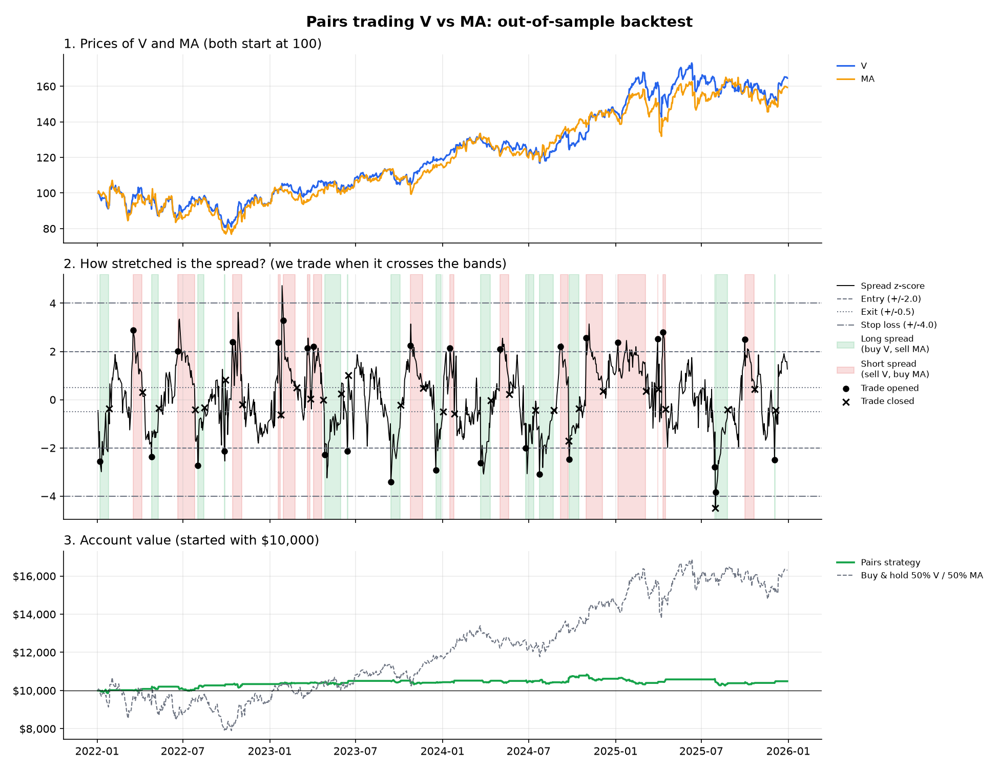

# Pairs Trading: A Statistical Arbitrage Backtester

A Python project that finds two stocks that usually move together, waits for them to drift apart, bets on them coming back together, and then honestly tests whether that would have made money.



## Why am I doing this project?

I wanted this to be a starting point for my journey of self-learning quant concepts. My objectives are to:

- see how Python is used in making simple algo / quant projects
- learn some useful math concepts
- see where trading strategies fail in real life

## How to run it

```bash
git clone https://github.com/Narayanan1408/pairs-trading.git
cd pairs-trading
python3 -m venv .venv
source .venv/bin/activate          # Windows: .venv\Scripts\activate
pip install -r requirements.txt
```

| What | Command |
| :---- | :---- |
| Backtest the best pair and save charts | `python main.py` |
| Backtest a pair you choose | `python main.py --pair KO PEP` |
| Robustness checks | `python robustness.py` |
| Interactive dashboard | `streamlit run app.py` |
| Step-by-step notebook | `jupyter notebook demo.ipynb` |
| Unit tests | `pytest` |

# Notes

## General outline of the project

| Step | Description | Output |
| :---- | :---- | :---- |
| **Idea (Hypothesis)** | When two related stocks drift unusually far apart, the gap between them tends to close. | A claim we can test |
| **Data** | • Downloaded one closing price per trading day for 16 stocks from 2018 to 2025 (about 2,000 days each) from Yahoo Finance.<br>• Removed KDP, as its history before the 2018 merger is distorted.<br>• Prices are adjusted for stock splits and dividends. (Without this, a stock split would look like a crash and give a false signal.)<br>• Only stocks in the same business are paired, as they are driven by the same news and customers. | A table with one row per day and one column per stock |
| **Pair Selection** | • Tested all 15 possible same-industry pairs, using only 2018–2021 prices, with the cointegration test.<br>• Correlation only says two stocks move in the same direction. Two stocks can both rise every year (high correlation) while the gap between them keeps growing, which would be a disaster for this strategy. | A ranked list. The lowest p-value and strongest link is Visa/Mastercard (p = 0.019): if there were no real link, a pattern this strong would appear only about 2% of the time. |
| **Signal** | **1. Find the normal relationship** between Visa and Mastercard on a log scale:<br>log(Visa) = 0.53 + 0.82 × log(Mastercard)<br>• 0.82 is the hedge ratio (when Mastercard moves 1%, Visa normally moves about 0.82%).<br>• The hedge ratio is calculated once using 2018–2021 prices and kept constant for the backtest.<br><br>**2. Find the spread (the gap):** where Visa should be given Mastercard's price, and how far it actually is from that. A spread of −0.057 means Visa was about 5.7% cheap.<br><br>**3. Calculate the z-score:** how many standard deviations today's gap is above or below its recent average.<br>$z = \frac{x - \mu}{\sigma}$<br>• x is today's gap (spread)<br>• μ is the average of the last 30 spread values (including today), recalculated every day on a rolling window<br>• σ is the standard deviation of the same last 30 spread values | One z-score per day |
| **Trading Rules** | 1. Z < −2: long Visa and short Mastercard **(+1)**, because Visa is unusually cheap<br>2. Z > +2: short Visa and long Mastercard **(−1)**, because Visa is unusually expensive<br>3. Take profit **(0)**: close a long when Z rises back above −0.5, close a short when Z falls back below +0.5<br>4. Stop loss **(0)**: close if Z goes beyond +4 or −4 | One position per day: +1, −1 or 0 |
| **Back Test** | • Simulated trading on 2022–2025 prices with a starting balance of \$10,000.<br>• No look-ahead: a decision made at today's closing price is placed at today's close, so it only earns the next day's price move. It never earns today's move, which keeps the backtest honest.<br>• Each time a trade opens or closes it pays a 0.05% fee, to imitate real broker costs.<br><br>Daily return = yesterday's position × (Visa's % move − 0.82 × Mastercard's % move) ÷ 1.82 − fees | A daily account balance and a diary of every trade (when it opened and closed, direction, profit) |
| **Evaluation** (Visa / Mastercard) | • Total return: +4.9%<br>• Yearly volatility: 3.8%<br>• Sharpe ratio: 0.34<br>• Worst drop: −5.4%<br>• Trades: 31<br>• Win rate: 61%<br>• Time in market: 40%<br>• Return from buying and holding both: +62.9% | A scorecard and the backtest charts |
| **Robustness** | Checked whether the result was real or just luck by changing one thing at a time:<br><br>**1. Different settings:** tried 16 entry/exit combinations and 5 z-score windows (10–90 days).<br>→ Entry/exit changes mostly stayed slightly positive, but the 10- and 20-day windows lost money.<br><br>**2. More realistic trading:** higher fees and trading one day late.<br>→ The profit disappears once fees exceed about 0.15%, and trading one day late lowers the return from +4.9% to +1.5%.<br><br>**3. Every pair:** traded all 15 pairs in 2022–2025.<br>→ Only 6 of 15 made money. Pairs that passed the cointegration test did no better than pairs that failed it.<br><br>**4. Walk-forward (2013–2025):** each year, pick pairs using the previous 3 years, trade them for 1 year, then repeat.<br>→ Lost 20% overall, and lost money in 6 of the 9 years it traded.<br><br>**5. Luck check (t-statistic):**<br>$t = \frac{\text{average daily return}}{\text{std dev of daily returns}} \times \sqrt{\text{number of days}}$<br>• A t-statistic above about 2 matches a p-value below 0.05. We would then reject the null hypothesis ("the strategy's true average return is zero") and say the edge is probably real.<br>→ V/MA scored only 0.67, so the result could easily be luck. | The model is not robust (see `images/robustness.png`) |
| **Conclusion** | • The V/MA strategy made a small, steady, low-risk profit (+4.9%, worst drop −5.4%) that did not depend on the market going up or down (market neutral).<br>• It did not beat simply holding both stocks (+62.9%).<br>• The robustness checks show the result is not convincing: it depends on specific settings, low fees and lucky timing, and repeating the whole process every year lost money. | |


## Program structure

```
pairs-trading/
├── pairs_trading/
│   ├── config.py           # all settings in one place
│   ├── data.py             # download prices
│   ├── pair_selection.py   # cointegration scan
│   ├── strategy.py         # hedge ratio, spread, z-score, positions
│   ├── backtest.py         # returns, costs, trades, metrics
│   ├── pipeline.py         # runs all steps for one pair
│   └── plots.py            # charts
├── tests/test_strategy.py  # unit tests (offline)
├── images/                 # charts generated by main.py and robustness.py
├── main.py                 # command-line entry point
├── robustness.py           # robustness checks
├── demo.ipynb              # step-by-step Jupyter notebook
├── app.py                  # Streamlit dashboard
└── requirements.txt        # libraries to install
```

## Files

### `pairs_trading/config.py`
The settings file. It holds the list of candidate stocks grouped by industry, plus every number the strategy uses.
- **Dates:** formation period 2018–2021, trading period 2022–2025
- **Trading rules:** z-score window 30 days, entry ±2, exit ±0.5, stop loss ±4
- **Money:** starting capital \$10,000, fees 0.05%
- Change a number here and every other file uses the new value.

### `pairs_trading/data.py`
Downloads daily closing prices from Yahoo Finance.
- Prices are adjusted for stock splits and dividends.
- Returns a table: one row per day, one column per stock.
- Free, and needs no account or API key.

### `pairs_trading/pair_selection.py`
Finds which pairs of stocks are tied together.
- Tests every two-stock combination within each industry (15 pairs).
- Uses the cointegration test on 2018–2021 prices only.
- Returns the pairs ranked by p-value, lowest (strongest link) first.

### `pairs_trading/strategy.py`
The core maths. It has four functions, used in order:
1. `estimate_hedge_ratio`: regression giving log(Visa) = 0.53 + 0.82 × log(Mastercard)
2. `compute_spread`: the daily gap from that normal relationship
3. `compute_zscore`: how unusual the gap is, compared with the last 30 days
4. `generate_positions`: applies the trading rules and outputs +1, −1 or 0 for each day

### `pairs_trading/backtest.py`
Simulates the trading and scores it.
- `run_backtest`: daily profit and loss, the one-day delay (no look-ahead), fees, and the account balance
- `list_trades`: a diary of every trade (entry date, exit date, direction, profit)
- `performance_summary`: total return, Sharpe ratio, worst drop, win rate, and a buy-and-hold comparison

### `pairs_trading/pipeline.py`
Runs `strategy.py` and `backtest.py` in the right order for one pair.
- Learns on 2018–2021, then trades and scores 2022–2025.
- Used by `main.py`, `app.py` and the notebook, so all of them give the same answer.

### `pairs_trading/plots.py`
Draws all the charts:
- the pair-scan bar chart
- the hedge-ratio scatter plot
- the 3-panel backtest chart: prices, z-score with trades, account value
- the robustness chart

### `main.py`
Runs everything from the terminal.
- `python main.py` scans for the best pair and trades it.
- `python main.py --pair KO PEP` trades a pair you choose.
- Prints the scorecard and saves the charts to `images/`.

### `app.py`
The interactive dashboard (Streamlit).
- Sliders control the stocks, dates and trading rules.
- It has 4 tabs:
  - Backtest
  - Step-by-step replay, which explains each day's decision in words
  - Pair scanner
  - How it works

### `robustness.py`
Runs the 5 robustness checks:
- entry/exit and window settings
- fees and delays
- every pair
- walk-forward 2013–2025
- the t-statistic luck check

It prints the results and saves the chart as `images/robustness.png`.

### `demo.ipynb`
A Jupyter notebook that runs the same pipeline one step per cell: download, pair scan, backtest, charts and trades. The last cell lets you try your own settings.

### `tests/test_strategy.py`
Automatic checks using fake stocks with known answers. They confirm the cointegration test, the hedge ratio, the trading rules, the no-look-ahead rule and the fees all work correctly. Run them with `pytest`.

## Limitations

**1. Because the model is kept simple**
- **The hedge ratio is fixed.** It's calculated once from 2018–2021 and never updated, even though the relationship between the stocks changes over time.
- **Trading is idealised.** The model assumes we trade at the exact closing price used to make the decision, rebalance the money split perfectly every day, and pay one flat fee. It ignores short-selling costs (borrowing fees, margin, paying dividends to the lender).
- **The z-score assumes a smooth bell curve.** Real prices can jump overnight on news or earnings, skipping straight past the stop loss.
- **Free data.** Yahoo Finance data can contain errors (like KDP's distorted history).

**2. Because of how the stocks and pairs were chosen**
- **Hindsight in the stock list.** The stocks were picked in 2026, knowing they are successful companies that still exist (survivorship bias).
- **Testing many pairs finds some by luck.** At a 5% threshold, roughly 1 in 20 unrelated pairs passes the test anyway.

**3. Because of how markets work**
- **Relationships break.** Mergers, lawsuits or business changes can create a permanent gap that never closes.
- **The return is very small.** About 1.3% a year isn't worth doing without borrowing money (leverage), and leverage makes losses bigger too.
- **Too many people use it.** Pairs trading is widely known, so gaps close faster and profits have shrunk.

## References
- Gatev, Goetzmann & Rouwenhorst (2006), *Pairs Trading: Performance of a Relative-Value Arbitrage Rule*: the classic study and the formation / trading period design
- Engle & Granger (1987), *Co-integration and Error Correction*: the cointegration test
- Ernest Chan (2013), *Algorithmic Trading: Winning Strategies and Their Rationale*: cointegration-based pairs trading
- Do & Faff (2010), *Does Simple Pairs Trading Still Work?*: why profits have shrunk
- [QuantConnect Strategy Library](https://www.quantconnect.com/learning/articles/investment-strategy-library): project inspiration
