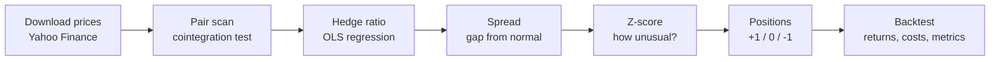
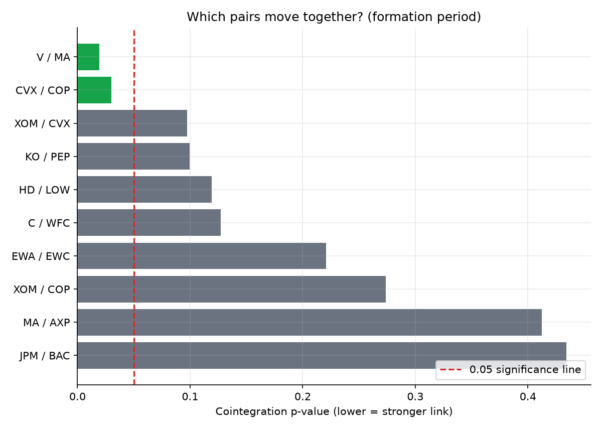
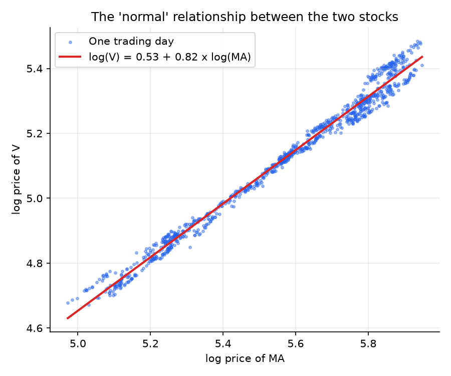
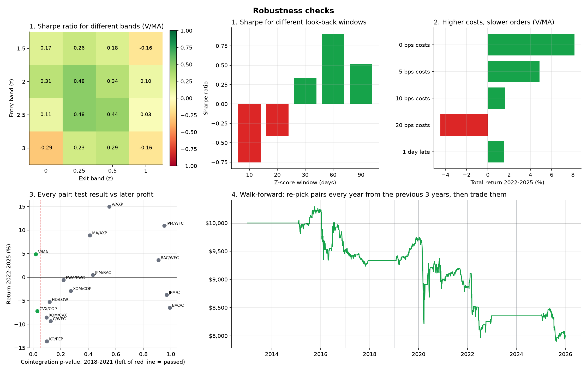

# 📈 Pairs Trading: A Statistical Arbitrage Backtester

> Find two stocks that move together, wait for them to drift apart, and bet on them snapping back.

A clean, fully tested Python implementation of **pairs trading**, one of the classic quantitative
strategies used by hedge funds since the 1980s. It includes:

- 🔍 **Pair scanner**: tests every same-industry pair for *cointegration* (a statistical "tie")
- 🧮 **Signal engine**: hedge ratio → spread → z-score → buy/sell decisions
- 💵 **Backtester**: realistic next-day execution, trading costs, and performance metrics
- 🖥️ **Interactive dashboard**: change any setting and *replay the strategy day by day*
- 🧪 **Robustness checks**: settings sensitivity, cost stress tests, every pair, and a 13-year walk-forward


---

## 💡 The idea in 30 seconds

Visa (V) and Mastercard (MA) run almost the same business, so their stock prices tend to move
together. Sometimes, for no lasting reason, one runs ahead of the other. When that gap becomes
**unusually large**, we:

| Situation | What we do | Why |
|---|---|---|
| V is unusually **cheap** vs MA | **Buy V, short-sell MA** | Bet the gap closes |
| V is unusually **expensive** vs MA | **Short-sell V, buy MA** | Bet the gap closes |
| Gap is back to normal | **Close the trade** | Take the profit |
| Gap keeps growing past a limit | **Close the trade** | Cut the loss (the pair may be "broken") |

Because we are always **long one stock and short the other**, a market-wide crash hits both legs
and roughly cancels out. That makes the strategy **market neutral**: it profits from the *gap*,
not from the market going up.

---

## 🔄 How it works



| Step | What happens | File |
|---|---|---|
| 1. **Data** | Download daily adjusted prices (2018 to 2025) | [`data.py`](pairs_trading/data.py) |
| 2. **Pair selection** | Run the Engle-Granger cointegration test on every same-industry pair. p < 0.05 means the pair is statistically tied together | [`pair_selection.py`](pairs_trading/pair_selection.py) |
| 3. **Hedge ratio** | Regress `log(A) = α + β·log(B)` on the **formation period only** (2018 to 2021) | [`strategy.py`](pairs_trading/strategy.py) |
| 4. **Spread & z-score** | `spread = log(A) − (α + β·log(B))`, then `z = (spread − rolling mean) / rolling std` | [`strategy.py`](pairs_trading/strategy.py) |
| 5. **Signals** | Enter at \|z\| > 2, exit at \|z\| < 0.5, stop loss at \|z\| > 4 | [`strategy.py`](pairs_trading/strategy.py) |
| 6. **Backtest** | Trade on unseen data (2022 to 2025), act the *next* day, pay 5 bps per trade | [`backtest.py`](pairs_trading/backtest.py) |

### Avoiding the classic backtesting mistakes
- **No look-ahead bias:** a decision made at today's close only earns *tomorrow's* return (`shift(1)`).
- **Out-of-sample testing:** the hedge ratio is learned on 2018 to 2021 and tested on 2022 to 2025, data it has never seen.
- **Trading costs included:** every position change pays 0.05%.
- **Rolling z-score:** uses only past data at every point in time.

---

## 📊 Results (V vs MA, 2022 to 2025, out of sample)

Step 1: the scanner ranks every pair. Visa / Mastercard is the most tightly linked:



Step 2: the regression finds the "normal" relationship between the two:



Step 3: the backtest:

| Metric | Pairs strategy |
|---|---|
| Total return | **+4.9%** |
| Annual volatility | 3.8% |
| Sharpe ratio | 0.34 |
| Max drawdown | **−5.4%** |
| Number of trades | 31 |
| Win rate | 61% |
| Time in market | 40% |
| *Buy & hold 50/50 V + MA* | *+62.9%* |

### 🧐 Honest interpretation
- The strategy **made money with very low risk**: a worst drawdown of only −5.4%, while being in the market just 40% of the time.
- It **did not beat buy-and-hold**. That's expected: 2022 to 2025 was a strong bull run for V and MA, and a market-neutral strategy deliberately gives up that market exposure.
- Results **vary a lot by pair**. Pairs that looked tied together in 2018 to 2021 (e.g. CVX/COP) lost money in 2022 to 2025, because relationships between companies change over time. This is the main real-world risk of pairs trading, and why professionals re-test pairs continuously.
- The robustness checks below show the V/MA result is **fragile**. Treat it as one lucky draw, not proof the strategy works.

---

## 🧪 Robustness checks

A single backtest can look good by luck. [`robustness.py`](robustness.py) asks whether the result
survives when we change the settings, make trading more realistic, try every pair, and repeat the
whole process year after year.



| # | Test | What we changed | Result | Verdict |
|---|---|---|---|---|
| 1 | **Entry / exit bands** | 16 combinations of entry (1.5 to 3.0) and exit (0 to 1.0) | Sharpe between −0.29 and 0.48. Positive in most cells; best around entry 2 to 2.5, exit 0.25 to 0.5 | 🟡 Somewhat stable |
| 1 | **Z-score window** | 10, 20, 30, 60, 90 days | Sharpe −0.75, −0.41, 0.34, 0.90, 0.52 | 🔴 Sensitive: short windows lose money |
| 2 | **Trading costs** | 0, 5, 10, 20 bps | +8.1%, +4.9%, +1.7%, −4.5% | 🔴 Profit disappears at ~15 bps |
| 2 | **Slower execution** | Act one day later | +1.5% (from +4.9%) | 🔴 Most of the edge is gone |
| 3 | **Every pair** | All 15 same-industry pairs, 2022 to 2025 | Only 6 of 15 made money. Pairs that *passed* the cointegration test did no better than pairs that failed it (average Sharpe 0.05 vs −0.06) | 🔴 The test did not predict later profits |
| 4 | **Walk-forward, 2013 to 2025** | Every year: scan the previous 3 years, trade every pair that passes, re-pick next year | **−20.0%** total, Sharpe −0.31. Lost money in 6 of the 9 years it traded | 🔴 The full recipe loses money |
| 5 | **Luck check** | t-statistic of daily returns (above ~2 = unlikely to be luck) | V/MA: 0.67. Walk-forward: −1.12 | 🔴 Not statistically significant |

### What this means
- **The headline V/MA result is not robust.** It depends on the 30-day window, low costs and same-day execution, and the t-statistic of 0.67 says it could easily be luck.
- **Cointegration in the past did not predict profits in the future** for these large, well-known stocks. Their relationships drift, and many professional traders already arbitrage them.
- **The walk-forward is the most honest test**, because it repeats the whole decision process the way a real trader would, with no hindsight about which pair works. It lost 20% over 13 years.
- This matches the research: simple pairs trading on US large caps has earned much less since the early 2000s (Do & Faff, 2010).

These results point to the improvements most likely to matter: a hedge ratio that updates over time,
less frequent trading to cut costs, and pairs where the economic link is stronger.

---

## 🚀 Getting started

### 1. Install
```bash
git clone https://github.com/Narayanan1408/pairs-trading.git
cd pairs-trading
python3 -m venv .venv
source .venv/bin/activate          # Windows: .venv\Scripts\activate
pip install -r requirements.txt
```

### 2. Run the backtest (command line)
```bash
python main.py                  # scan all pairs, trade the best one
python main.py --pair KO PEP    # trade a pair you choose
```
Charts are saved to `images/`.

To run the robustness checks (takes about a minute):
```bash
python robustness.py
```

Or open the step-by-step notebook [`demo.ipynb`](demo.ipynb):
```bash
jupyter notebook demo.ipynb
```

### 3. Launch the interactive dashboard
```bash
streamlit run app.py
```
Your browser opens with four tabs:

| Tab | What you can do |
|---|---|
| 📊 **Backtest** | See the metrics, the full chart, and every trade |
| ▶️ **Step-by-step replay** | Drag a date slider and read *why* the strategy bought, sold or waited that day |
| 🔍 **Pair scanner** | See which pairs are cointegrated |
| 📘 **How it works** | A plain-English explanation |

Every setting (stocks, dates, entry/exit bands, costs) is a slider in the sidebar.

### 4. Run the tests
```bash
pytest
```
The tests use synthetic (made-up) prices, so they run offline in under a second.

---

## 📁 Project structure

```
pairs-trading/
├── pairs_trading/
│   ├── config.py           # all settings in one place
│   ├── data.py             # download prices
│   ├── pair_selection.py   # cointegration scan
│   ├── strategy.py         # hedge ratio, spread, z-score, positions
│   ├── backtest.py         # returns, costs, trades, metrics
│   ├── pipeline.py         # runs all steps for one pair
│   └── plots.py            # charts
├── tests/test_strategy.py  # unit tests (offline)
├── images/                 # charts generated by main.py
├── main.py                 # command-line entry point
├── robustness.py           # robustness checks
├── demo.ipynb              # step-by-step Jupyter notebook
├── app.py                  # Streamlit dashboard
└── requirements.txt
```

---

## ⚙️ Settings

All in [`pairs_trading/config.py`](pairs_trading/config.py):

| Setting | Default | Meaning |
|---|---|---|
| `formation_start/end` | 2018 to 2021 | Period used to learn the relationship |
| `trading_start/end` | 2022 to 2025 | Unseen period used to test it |
| `zscore_window` | 30 days | History used for the spread's "normal" level |
| `entry_z` | 2.0 | Open a trade at this many standard deviations |
| `exit_z` | 0.5 | Close when back within this band |
| `stop_z` | 4.0 | Stop loss |
| `cost_bps` | 5 | Trading cost per dollar traded (0.05%) |

---

## 🔭 Possible extensions
- **Kalman filter** hedge ratio that updates every day instead of once
- **Portfolio of pairs** instead of a single pair, to diversify
- **Rolling re-selection**: re-run the cointegration test every year and swap out broken pairs
- **Half-life of mean reversion** (Ornstein-Uhlenbeck) to set the z-score window automatically

## 📚 References
- Gatev, Goetzmann & Rouwenhorst (2006), *Pairs Trading: Performance of a Relative-Value Arbitrage Rule*
- Do & Faff (2010), *Does Simple Pairs Trading Still Work?*, Financial Analysts Journal
- Ernest Chan, *Algorithmic Trading: Winning Strategies and Their Rationale* (2013)
- [QuantConnect Strategy Library: Pairs Trading with Stocks](https://www.quantconnect.com/learning/articles/investment-strategy-library)

---

*For educational purposes only. Not investment advice.*
